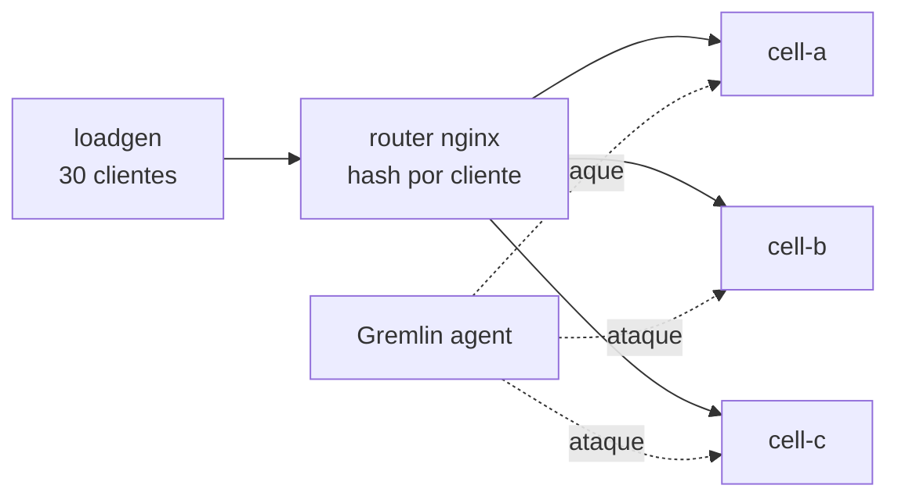

# Lab 1 – Gremlin: raio da explosão e testes por célula

## Conceito

Arquitetura **celular**: cada cliente é fixado em uma célula (`cell-a`, `cell-b`, `cell-c`). Se uma célula falha, só os clientes dela são afetados. Com o Gremlin, injetamos falhas de forma controlada e **expandimos o raio gradualmente**:



- **Blast radius** = *quais* alvos são afetados (1 container → 1 célula → todas).
- **Magnitude** = *quão forte* é o ataque (ex.: 200 ms vs 4000 ms de latência).

O dashboard em `http://localhost:8081` mostra SLI (sucesso e latência) por célula em tempo real.

## Opção A – Local (Docker)

```bash
cp .env.example .env        # preencha Team ID/Secret do Gremlin
sudo mkdir -p /var/lib/gremlin /var/log/gremlin
docker compose --env-file .env -f docker-compose.yml -f docker-compose.gremlin.yml up -d --build
```

- App via router: http://localhost:8080/?customer=7
- Dashboard: http://localhost:8081

## Opção B – AWS free tier via CloudFormation (automatizado)

Sobe uma EC2 t3.micro, instala Docker, clona este repositório e inicia tudo. **Demo:** as portas 8080 e 8081 ficam abertas ao mundo (`0.0.0.0/0`) — use só em contas descartáveis e destrua ao final.

```bash
export GREMLIN_TEAM_ID=...  GREMLIN_TEAM_SECRET=...
export REPO_URL=https://github.com/SEU_USUARIO/sre-chaos-lab.git   # repositório público
./scripts/deploy.sh              # cria os parâmetros SSM + stack CloudFormation
# o deploy imprime a URL: dashboard em http://<IP-PUBLICO>:8081
# (alternativa sem porta aberta: ./scripts/port-forward.sh 8081)
```

O bootstrap leva ~3–5 min (log em `/var/log/lab-setup.log` na instância).
Para voltar ao normal após um ataque (containers parados não reiniciam sozinhos; não há Auto Scaling): `./scripts/restore.sh`.
Para remover: `./scripts/destroy.sh`.

## Experimentos

Veja [EXPERIMENTOS.md](EXPERIMENTOS.md).

## Troubleshooting

- Agente não aparece no Gremlin: `docker logs gremlin-agent` (confira Team ID/Secret e saída para a internet).
- Após reiniciar uma célula, se o router devolver 502 de forma persistente: `docker compose restart router` (o nginx resolve nomes no start).
- Poucos recursos na t3.micro: o bootstrap cria 1 GB de swap; se necessário use `t3.small` (`--parameter-overrides InstanceType=t3.small`, sai do free tier).
