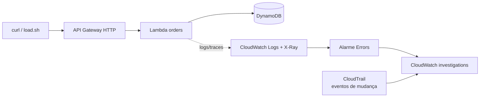

# Lab 2 – Diagnóstico assistido por IA com Amazon CloudWatch investigations

Objetivo: mostrar como a IA generativa da AWS (**CloudWatch investigations**, o "Investigate") correlaciona métricas, logs, traces e eventos de mudança (CloudTrail) para sugerir hipóteses de causa raiz, e como o SRE **valida** esse diagnóstico.



## Pré-requisitos

- AWS CLI v2 atualizado (`aws aiops help`), `curl`
- Credenciais com permissão administrativa em conta de laboratório
- Região com suporte ao CloudWatch investigations (padrão `us-east-1`; mude com `export AWS_REGION=...`)

## Passo a passo

```bash
./scripts/deploy.sh            # stack CloudFormation + investigation group
./scripts/load.sh 60           # baseline: tudo 201
./scripts/inject-fault.sh bad-config
./scripts/load.sh 120          # aparecem 500; alarme dispara em ~1-2 min
```

No console: **CloudWatch → Alarmes** (ou **Investigations**) → alarme `sre-lab-orders-lambda-errors` → **Investigate / Start investigation**. Compare com o gabarito em [NOTAS_INSTRUTOR.md](NOTAS_INSTRUTOR.md).

Depois: `./scripts/restore.sh`, repita com `iam-deny` e compare os diagnósticos. Cleanup: `./scripts/destroy.sh`.

## Material dos alunos

[ROTEIRO_ALUNO.md](ROTEIRO_ALUNO.md) — folha de investigação (primeiro humanos, depois a IA).

## Observações

- A investigação pode levar alguns minutos e **não é determinística**; tenha prints como plano B.
- Se `aws aiops create-investigation-group` falhar, faça o setup único pelo console e use a role `sre-lab-orders-investigations-role` (output `InvestigationsRoleArn`).
- O código do Lambda está inline no template (`cloudformation/lab2.yaml`).
- As falhas são injetadas por CLI fora da stack (gera *drift* intencional); `restore.sh` volta ao estado original e o `destroy.sh` limpa tudo antes de apagar a stack.
- Verifique limites e preços atuais do CloudWatch investigations antes de usar em sala.
